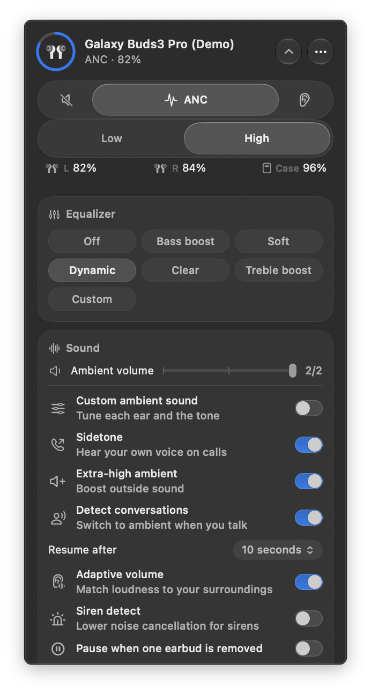

# Buds Hub

A native macOS menu bar client for Samsung Galaxy Buds. No phone app, no Electron,
no account. It talks to the earbuds over their Samsung RFCOMM control service and
puts the useful controls one click away.

Built with SwiftUI + IOBluetooth, with a protocol layer reverse-engineered from
live Galaxy Buds3 Pro traffic and cross-checked against the GalaxyBudsClient
project.



## Features

- **Noise control** — Off, ANC and Ambient, with Low/High ANC level on models that
  report it. Adaptive is gated to models that actually accept it.
- **Battery** — left, right and case, charging state, low-battery colouring, and a
  battery ring in the menu bar icon.
- **Equalizer** — Off + the five Samsung presets (Bass boost, Soft, Dynamic, Clear,
  Treble boost) and a 9-band custom EQ on Buds3-generation and newer.
- **Custom ambient sound**, sidetone, extra-high ambient, detect conversations
  with timeout, ANC with one earbud, adaptive volume, siren detect, auto pause,
  speak seamlessly, spatial audio, head tracking and game mode where supported.
- **Gestures** — touchpad lock, single/double/triple/hold toggles, call gestures,
  volume swipe, double-tap-side volume and per-side touch-and-hold actions.
- **Find my earbuds** and **fit test** with left/right results.
- **Device info** — model, firmware, SKU, build, revision, multipoint state.
- **Global shortcuts** with a HUD, no Accessibility permission required.
- **Auto reconnect** when the buds come back to the Mac, and optional remembered
  noise/EQ settings per device.
- **Multi-device** — detects the model from the vendor SPP UUID product ID, then
  from the firmware SKU, then the name; manual override is available in Settings.
- **Developer tools** — live packet log with direction, message names, hex and
  decoded summaries, plus a raw command sender.

## Supported devices

The app ships profiles for every Galaxy Buds generation:

| Model | Build | Noise control | Custom EQ | Case battery |
|---|---|---|---|---|
| Galaxy Buds | R170 | Ambient | — | — |
| Galaxy Buds+ | R175 | Ambient | — | ✓ |
| Galaxy Buds Live | R180 | ANC | — | ✓ |
| Galaxy Buds Pro | R190 | ANC + level | — | ✓ |
| Galaxy Buds2 | R177 | ANC + level | — | ✓ |
| Galaxy Buds2 Pro | R510 | ANC + level | — | ✓ |
| Galaxy Buds FE | R400N | ANC + level | — | ✓ |
| Galaxy Buds Core | R410 | ANC + level | — | ✓ |
| Galaxy Buds3 | R530 | ANC + level | ✓ | ✓ |
| Galaxy Buds3 Pro | R630 | ANC + level | ✓ | ✓ |
| Galaxy Buds3 FE | R420 | ANC + level | ✓ | ✓ |
| Galaxy Buds4 | R540 | ANC + level + adaptive | ✓ | ✓ |
| Galaxy Buds4 Pro | R640 | ANC + level + adaptive | ✓ | ✓ |

Controls are gated per model; unsupported features never appear. The Buds3 Pro is
the hardware-verified target (firmware `R630XXU0AZG2`): connection, handshake,
battery, noise mode, equalizer, ambient volume, gesture flags, find-my-earbuds and
the packet log were exercised on a live unit. Other profiles are ported from the
GalaxyBudsClient specification and packet fixtures; please open an issue with a
packet log if a control is missing or wrong on your model.

## Requirements

- macOS 14 Sonoma or later (Apple silicon or Intel)
- Galaxy Buds paired with the Mac in **System Settings › Bluetooth**
- Bluetooth permission for Buds Hub

## Build

```sh
./build.sh
open build/BudsHub.app
```

The script builds with SwiftPM, generates the icon, writes `Info.plist` and
ad-hoc signs the bundle. macOS asks for Bluetooth permission once per re-signed
build; approve it in the system dialog.

Development with the Command Line Tools (no Xcode):

```sh
export SDKROOT=/Library/Developer/CommandLineTools/SDKs/MacOSX26.5.sdk
swift build                 # build library + app
swift test                  # protocol and model tests
swift run BudsHub --demo    # run with a simulated Buds3 Pro
swift run BudsProbe AA:BB:CC:DD:EE:FF  # hardware smoke test, prints live state
```

The bundled Command Line Tools 27 SDK exposes SwiftUI property wrappers as macros
without shipping the macro plugin, so `build.sh` pins the installed
`MacOSX26.5.sdk`. With full Xcode, use the default SDK and omit `SDKROOT`.

## How it works

1. Open the Samsung SPP service `2e73a4ad-332d-41fc-90e2-16bef06523f2`
   (`GEARMANAGER`) on the paired buds.
2. Read the extended status the buds push on connect.
3. Reply with Manager Info and the current time so the firmware accepts the client.
4. Ask for the SKU (`SM-R630…`) to identify the exact model.
5. Send commands using the 16-bit SPP frame (or the legacy 8-bit frame on the
   original Buds) with CRC-16/XMODEM in little-endian order.

More detail, including the verified Buds3 Pro status offsets and command
experiments, is in [docs/REVERSE_ENGINEERING.md](docs/REVERSE_ENGINEERING.md).

## Safety

Buds Hub does not expose firmware flashing, factory reset, pairing-mode writes or
raw memory/debug commands in the UI. The developer tab can send arbitrary SPP
messages and is intended for protocol work; unknown commands can change earbud
behaviour.

The app is unofficial and not affiliated with Samsung.

## Credits and licence

- Protocol knowledge, message IDs and model specifications:
  [GalaxyBudsClient](https://github.com/timschneeb/GalaxyBudsClient) (GPLv3).
- UI interaction patterns (battery ring, liquid segmented control, glass
  fallbacks, HUD):
  [BudsControl](https://github.com/amarsakore/BudsControl) (MIT).

Buds Hub is distributed under the GNU General Public License v3. See [LICENSE](LICENSE)
and [THIRD_PARTY_NOTICES.md](THIRD_PARTY_NOTICES.md).
